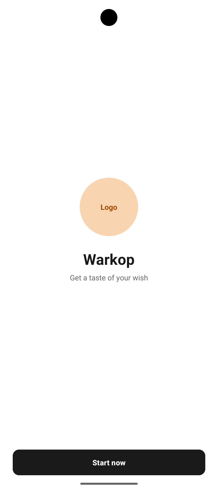
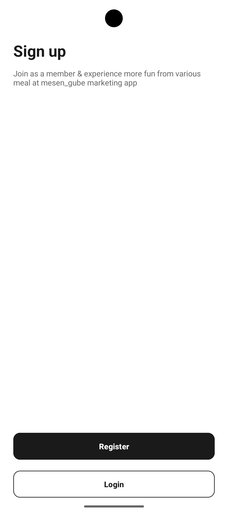
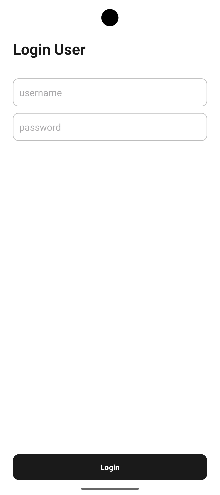
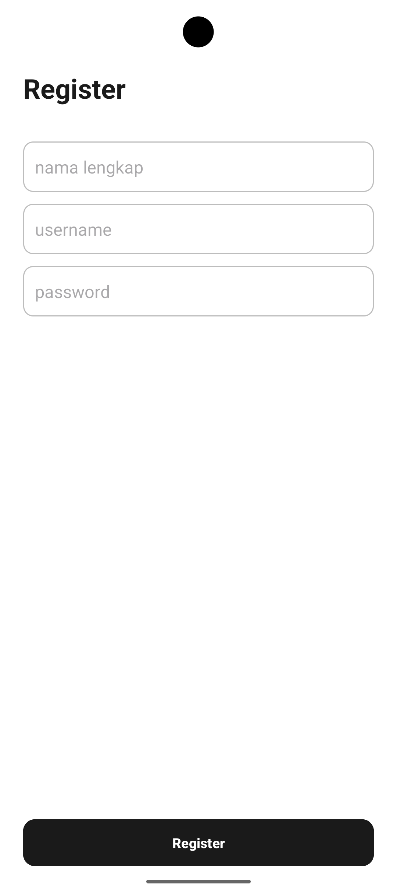
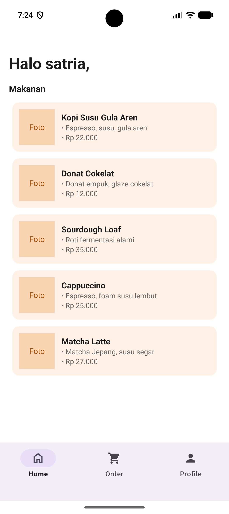
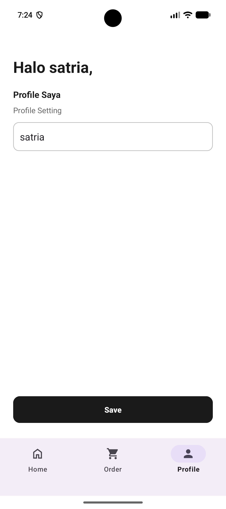
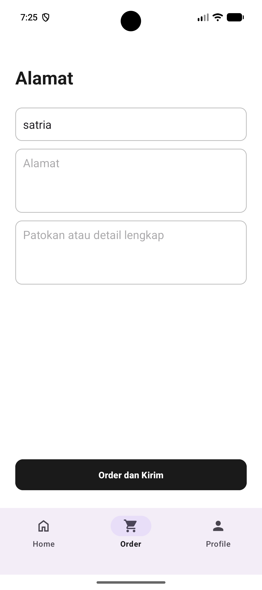
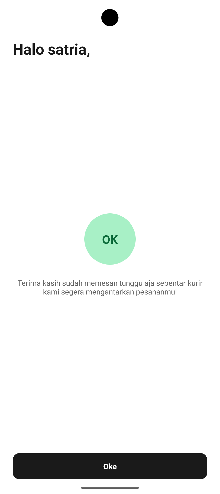

# ☕ Warkop

Aplikasi pemesanan makanan dan minuman berbasis Android bernama **Warkop** (*Kopi dan Nyemil — Get a taste of your wish*). Pengguna dapat mendaftar, masuk, melihat daftar menu, mengubah profil, lalu memesan dengan mengisi alamat pengiriman.

Dibuat sebagai tugas mata kuliah Pemrograman Aplikasi Mobile (PAM)

## ✨ Fitur

- **Splash / Welcome** dengan logo dan tombol *Start now*
- **Sign up** dengan pilihan Register atau Login
- **Register** akun baru (nama lengkap, username, password)
- **Login** dengan validasi akun yang sudah terdaftar
- **Home** berisi daftar menu makanan dan minuman dalam **RecyclerView**
- **Profile** untuk mengubah nama pengguna
- **Order** berisi form alamat pengiriman (nama, alamat, patokan)
- **Konfirmasi pesanan** setelah menekan *Order dan Kirim*
- **Adaptive Layout**: daftar menu otomatis 1, 2, atau 3 kolom sesuai lebar layar (HP, tablet kecil, tablet besar)

## 🔄 Alur Aplikasi

```
Splash → Sign up → Register ──┐
                 → Login ─────┤
                              ▼
                    Home (Bottom Navigation)
                    ├── Home    : daftar menu (RecyclerView)
                    ├── Order   : alamat → Konfirmasi → kembali ke Home
                    └── Profile : ubah nama
```

## 🛠️ Teknologi

- Bahasa: **Kotlin**
- UI: **XML Views**, Material Components (Material 3)
- Komponen utama: RecyclerView, CardView, BottomNavigationView, Fragment
- Penyimpanan data pengguna: **SharedPreferences**
- Minimum SDK: **API 27** (Android 8.1 "Oreo")
- IDE: Android Studio

## 📁 Struktur Project

```
lat.pam.warkop
├── SplashActivity.kt
├── SignUpActivity.kt
├── RegisterActivity.kt
├── LoginActivity.kt
├── MainActivity.kt          (BottomNavigationView + Fragment)
├── ConfirmationActivity.kt
├── HomeFragment.kt
├── OrderFragment.kt
├── ProfileFragment.kt
├── MenuItem.kt              (data class)
├── MenuAdapter.kt           (adapter RecyclerView)
└── UserPrefs.kt             (penyimpanan data user)
```

## ▶️ Cara Menjalankan

1. Clone repository ini:
   ```
   git clone [link repository]
   ```
2. Buka folder project di **Android Studio**.
3. Tunggu proses **Gradle Sync** selesai.
4. Pilih emulator atau perangkat fisik (minimum Android 8.1).
5. Klik tombol **Run ▶**.

## 🧪 Cara Menggunakan

1. Tekan **Start now**, lalu pilih **Register** dan isi data akun.
2. Setelah berhasil, Anda masuk ke halaman **Home**.
3. Buka tab **Profile** untuk mengubah nama, lalu tekan **Save**.
4. Buka tab **Order**, isi alamat pengiriman, lalu tekan **Order dan Kirim**.
5. Tekan **Oke** pada halaman konfirmasi untuk kembali ke Home.

> Data akun disimpan secara lokal di perangkat. Jika aplikasi dihapus atau datanya dibersihkan, akun harus didaftarkan ulang.

## 📸 Tampilan Aplikasi

<p align="center">
  
  
  
  
</p>

<p align="center">
  
  
  
  
</p>
